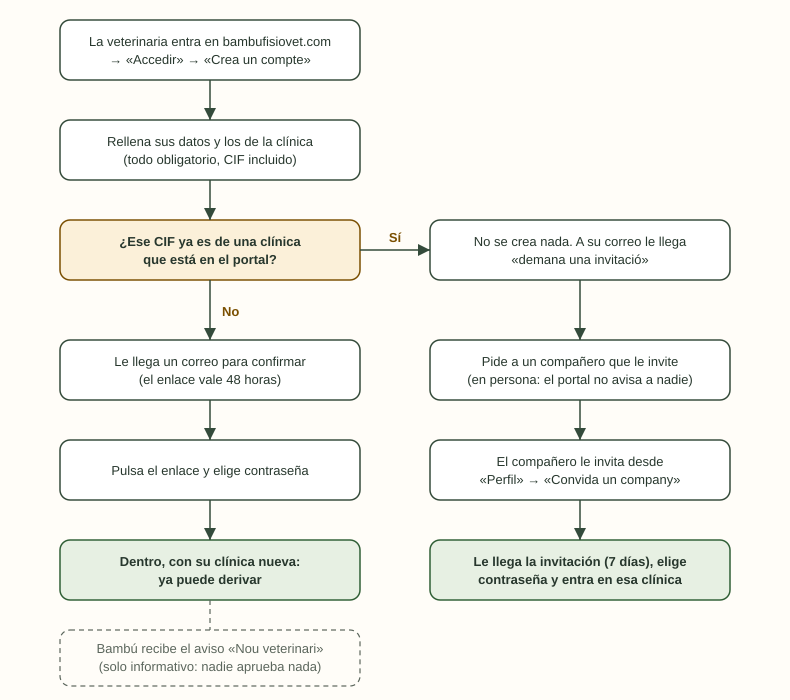
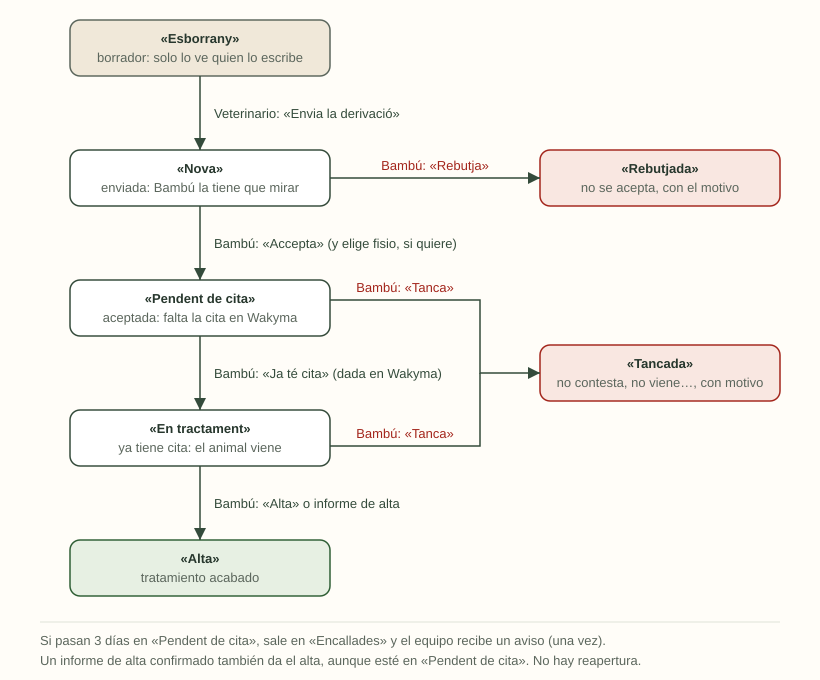
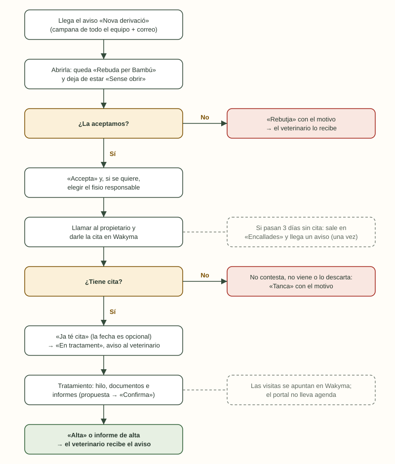

# Guía del portal BAMBÚ Fisiovet

Cómo funciona el portal, en orden y en lenguaje llano. Primero el recorrido
del veterinario que deriva; después, qué hace Bambú con cada derivación. Al
final, los diagramas.

Los nombres entre comillas («Accedir», «Ja té cita»…) son los botones y las
pestañas tal como salen en pantalla, en valenciano.

---

## Cómo probar

El portal está en **bambufisiovet.com**. Los casos, clínicas y pacientes que
veis son de prueba: se pueden tocar sin miedo.

### Accesos

Todas las cuentas entran por **https://bambufisiovet.com** → «Accedir», con el
correo (o el usuario) y la contraseña.

| Para qué | Usuario | Contraseña |
|---|---|---|
| **Veterinaria de prueba**: Marta Puig, Clínica Veterinària Sant Roc. Ve lo que ve una clínica | nando3e@gmail.com | En la versión Word |
| **Fisio de Bambú de prueba**: Laia Serra. Es la cuenta para probar el día a día de Bambú | nando3e+laia@gmail.com | En la versión Word |
| **Superadmin** (llave maestra de Bambú): además configura el correo y la IA | En la versión Word | En la versión Word |

- Las contraseñas no se guardan en este repositorio: están en la versión Word
  de la guía, que reparte Nando.
- Para probar como Bambú, mejor la cuenta de Laia. El superadmin es la llave
  maestra: solo para configurar, y no se comparte fuera del equipo.
- Los avisos de las cuentas de prueba llegan al Gmail de Nando.
- Cuando acaben las pruebas, se cambian estas contraseñas y se desactivan las
  cuentas de prueba.

**Qué recorrer**

1. **Como veterinario**: entrar, hacer una derivación nueva (los tres pasos),
   dejar otra a medias en «Esborranys», escribir en el hilo de un caso y
   adjuntar una foto o un PDF.
2. **Como Bambú**: abrir la derivación nueva, aceptarla eligiendo fisio,
   marcar «Ja té cita», colgar un informe en el hilo con «Adjunta un fitxer»,
   escribir una nota interna y dar el alta. Probar también «Rebutja» y
   «Tanca» en otros casos.
3. **Los avisos**: comprobar que cada paso le llega al otro lado (la campana y
   el correo) y que el punto rojo se apaga al abrir el caso.
4. **En el móvil**: lo mismo desde el teléfono.
5. **Las ayudas**: el círculo con la «i» de cada pantalla. ¿Se entiende?

**Si algo falla o no se entiende**, avisad a Nando con:

- qué estabais haciendo y con qué cuenta (veterinario o Bambú);
- el caso (el nombre del paciente);
- qué esperabais y qué ha pasado;
- una captura de pantalla, si se puede.

---

## Antes de empezar: quién es quién

| Quién | Qué hace en el portal |
|---|---|
| **Veterinario** | Trabaja en una clínica, deriva casos a Bambú y los sigue. Solo ve los casos de su clínica. |
| **Equipo de Bambú** (fisios) | Recibe las derivaciones, las acepta o no, da la cita en Wakyma, cuelga los informes (hechos en Wakyma) y habla con el veterinario por el hilo del caso. Ve todos los casos. |
| **Superadmin** | Una cuenta de Bambú con llave maestra: configura el servidor de correo (y las claves de IA, para cuando se activen los informes del portal). |
| **Propietario del animal** | No entra al portal. Bambú le llama por teléfono para darle cita. |
| **Wakyma** | El programa de agenda de Bambú. Las visitas se apuntan allí, no en el portal. |

**Las tres reglas de oro**

1. **El portal solo recibe derivaciones.** Bambú no las registra en nombre de
   nadie: si una clínica llama por teléfono, se le dice que se registre en el
   portal.
2. **Las visitas van en Wakyma.** El portal solo necesita saber que el animal
   «ya tiene cita».
3. **Cada veterinario solo ve lo de su clínica**, y a una clínica que ya está
   en el portal solo se entra si te invita un compañero.

---

## Los estados de una derivación

Cada derivación está siempre en uno de estos siete estados. La tabla dice qué
significa cada uno, qué tiene que pasar para salir de él, a qué estado pasa y
quién lo hace. El diagrama 2, al final, lo dibuja.

| Estado | Qué significa | Qué tiene que pasar | Pasa a | Quién |
|---|---|---|---|---|
| **«Esborrany»** | La derivación está a medias. Solo la ve quien la escribe | Pulsar «Envia la derivació» con todo rellenado | «Nova» | Veterinario |
| | | Pulsar «Descarta l'esborrany» | Desaparece (no pasa a ningún estado) | Veterinario |
| **«Nova»** (el veterinario la ve como «Enviada») | Enviada; Bambú la tiene que mirar. El veterinario aún puede corregir datos | Pulsar «Accepta» (y, si se quiere, elegir el fisio) | «Pendent de cita» | Bambú |
| | | Pulsar «Rebutja» y escribir el motivo | «Rebutjada» | Bambú |
| **«Pendent de cita»** | Aceptada. Falta llamar al propietario y darle cita en Wakyma | Dar la cita en Wakyma y pulsar «Ja té cita» (la fecha es opcional) | «En tractament» | Bambú |
| | | Pulsar «Tanca» con el motivo (no contesta, no viene, lo descarta) | «Tancada» | Bambú |
| **«En tractament»** | Ya tiene cita: el animal viene a Bambú. Se habla por el hilo y se cuelgan los informes | Pulsar «Alta» | «Alta» | Bambú |
| | | Pulsar «Tanca» con el motivo | «Tancada» | Bambú |
| **«Alta»** | Tratamiento acabado | — | Es final: no cambia | — |
| **«Rebutjada»** | Bambú no la ha aceptado; el motivo queda escrito | — | Es final: no cambia | — |
| **«Tancada»** | Se cerró sin terminar el tratamiento; el motivo queda escrito | — | Es final: no cambia | — |

**Cosas que conviene saber**

- **Solo se avanza, nunca se vuelve atrás.** No hay botón para reabrir. Si el
  animal vuelve (una recaída, otra lesión), el veterinario hace una derivación
  nueva del mismo paciente.
- **El veterinario solo mueve dos cosas**: enviar su borrador y descartarlo.
  Todo lo demás lo hace Bambú.
- **«Encallada» no es un estado.** Es una marca para las derivaciones que
  llevan más de 3 días en «Pendent de cita». Siguen en ese estado, pero salen
  también en la pestaña «Encallades» y el equipo recibe un aviso, una sola
  vez.
- **«Sense obrir» tampoco es un estado.** Es una derivación «Nova» que nadie de
  Bambú ha abierto todavía. Al abrirla, el veterinario ve «Rebuda per Bambú».
- **Hasta que Bambú la acepta**, el veterinario puede corregir los datos de su
  derivación. Después, lo que quiera añadir lo escribe en el hilo.
- **Cada cambio de estado avisa al veterinario** y queda apuntado en el hilo
  del caso y en su historial.
- **En la ficha del caso, arriba, se ve como una línea temporal**: círculo
  lleno en los pasos hechos (con su fecha), círculo vacío y marcado en el
  siguiente paso, y gris lo que falta. Si acaba rechazada o cerrada, el último
  círculo sale en rojo o en gris.

---

## Parte 1. El recorrido del veterinario

### Paso 1. Darse de alta (una sola vez)

1. Entra en **bambufisiovet.com** y pulsa «Accedir» (o «Deriva un cas»).
   Elige «Crea un compte».
2. Rellena **todo**: nombre, apellidos, correo, teléfono, número de
   colegiado, nombre de la clínica, población y **CIF o NIF de la clínica**.
   Marca que acepta la política de privacidad.
3. La pantalla siempre dice lo mismo: «T'hem enviat un correu».
4. **Le llega un correo** con un enlace para confirmar. El enlace vale
   **48 horas**.
5. Pulsa el enlace, elige su contraseña y ya está dentro, en «Nova
   derivació», listo para derivar.
6. Bambú recibe un aviso: «Nou veterinari». Es solo informativo; nadie tiene
   que aprobar nada.

**Qué puede pasar**

- **El CIF ya es de una clínica que está en el portal.** No se crea nada. A
  su correo (no a la clínica) le llega: «aquesta clínica ja és al portal,
  demana a algú que et convide». Tiene que pedir a un compañero que le
  invite (ver paso 7).
- **No le llega el correo.** Que mire en el correo no deseado. Desde la
  pantalla de acceso puede pedir que se lo reenvíe.
- **Se le pasaron las 48 horas.** Que vuelva a darse de alta con el mismo
  correo: le llega un enlace nuevo.
- **Alguien se registró antes con ese CIF y nunca confirmó.** Mientras su
  enlace siga vigente, la clínica es de quien llegó primero. Cuando caduca y
  sigue sin confirmar, se retira sola y el CIF queda libre.

### Paso 2. Entrar cada día

- «Accedir», correo y contraseña. Entra en su lista de derivaciones.
- **¿Ha olvidado la contraseña?** «Has oblidat la contrasenya?» le manda un
  enlace por correo (vale 1 hora).
- En la lista tiene cuatro pestañas: «Totes», «En curs», «Esborranys» y
  «Tancades». Con la casilla «Amb novetats» ve solo los casos con avisos que
  no ha leído (llevan un punto rojo). El círculo con la «i» lo explica.

### Paso 3. Derivar un caso

«Nova derivació» tiene tres pasos:

1. **«Pacient i propietari»**: datos del animal y del propietario. Si el
   animal ya se derivó antes, lo busca y se rellenan solos.
2. **«Motiu i documents»**: por qué lo deriva y el tratamiento actual (solo
   esos dos campos), y debajo tres cajones para subir lo que tenga a mano:
   **Radiografies**, **Informes** y **Analítiques**. Van subiendo mientras
   escribe (las fotos se reducen antes de salir del móvil) y «Envia» espera a
   que acaben. También puede añadirlos después desde «Fitxa» → «Documents».
3. **«Consentiment i enviament»**: confirma que el propietario acepta que sus
   datos lleguen a Bambú (si ya lo aceptó antes, no hace falta) y pulsa
   «Envia la derivació».

- **Se guarda solo** mientras escribe. Si lo deja a medias, lo tiene en
  «Esborranys» y lo puede seguir en otro momento o en el ordenador.
- **Un borrador solo lo ve quien lo escribe.** Se puede descartar.
- Si falta algo al enviar, el portal le lleva al campo que falta.

### Paso 4. Después de enviar

La derivación pasa por estos estados. En cada cambio, el veterinario recibe un
aviso:

| Estado en pantalla | Qué significa | Qué le llega al veterinario |
|---|---|---|
| «Nova» (para él, «Enviada») | Bambú la tiene que mirar | Cuando Bambú la abre, en la ficha pone «Rebuda per Bambú» |
| «Pendent de cita» | Bambú la ha aceptado y llamará al propietario | Aviso «Derivació acceptada» |
| «Rebutjada» | Bambú no la acepta | Aviso con el motivo |
| «En tractament» | El animal ya tiene cita | Aviso «ha començat el tractament» |
| «Alta» | Tratamiento acabado | Aviso «ha rebut l'alta» |
| «Tancada» | Se cerró sin tratamiento (no contesta, no viene…) | Aviso con el motivo |

- **Mientras Bambú no la ha aceptado, puede corregir los datos.** Después ya
  no: lo que haga falta añadir, por el hilo.

### Paso 5. Durante el tratamiento

- **El hilo del caso** es para hablar con Bambú, como un chat: sus mensajes a
  la derecha (en blanco) y los de Bambú a la izquierda (en verde). Para
  adjuntar algo suelto, «Adjunta un fitxer»: queda preparado junto al texto
  y sale con «Envia», pegado al mensaje. Las fotos se ven en el hilo;
  cualquier adjunto se abre al pulsarlo.
- **Los documentos del caso** (radiografías, informes, analíticas) están en
  «Fitxa» → «Documents», agrupados por tipo, con su botón «Afig» en cada
  grupo mientras el caso está en marcha. Todo lo que se sube ahí sale
  también en el hilo, con su etiqueta.
- **Los informes** los hace Bambú en Wakyma y se los adjunta en el hilo del
  caso: le llega el aviso «Document nou» a la campana (y por correo) y los
  abre desde el hilo.
- Los avisos le llegan a la campana y, si no lo ha apagado, también por
  correo. En «Perfil» → «Rebre avisos per correu» decide si quiere correos.

### Paso 6. El final

- Con el alta (o si se cierra), el caso pasa a «Tancades». Queda como archivo.
- **Si el animal vuelve** (recaída, otra lesión): una derivación nueva del
  mismo paciente. En la ficha del paciente se ven todas.

### Paso 7. Los compañeros de la clínica

- Desde «Perfil» → «Convida un company», con nombre y correo.
- Al compañero le llega un correo (vale **7 días**), elige contraseña y entra
  directamente en la clínica. Ve los mismos casos.
- **Es la única forma de entrar en una clínica que ya está en el portal.**
  Nadie puede pedir entrar por su cuenta, ni Bambú mete a nadie.
- Una clínica que prefiera **una sola cuenta** (por ejemplo, la de
  recepción) puede no invitar a nadie.
- **El CIF de la clínica** lo ve en su perfil pero no lo puede cambiar; si
  está mal, lo corrige Bambú.

### Escenarios rápidos

| Qué pasa | Qué hacer |
|---|---|
| Un compañero quiere derivar | Que le invite alguien de la clínica desde su perfil |
| Se registró con el CIF de su clínica y le llegó «demana una invitació» | Pedir a un compañero que le invite. Si no hay nadie en el portal, hablar con Bambú |
| Se equivocó en un dato y la derivación ya está aceptada | Escribirlo en el hilo |
| Quiere dejar de recibir correos | «Perfil» → apagar «Rebre avisos per correu» (la campana sigue) |
| Alguien deja la clínica | Avisar a Bambú: lo desactiva y pierde el acceso al momento |
| Ya tiene cuenta en otra clínica y se cambia | De momento lo resuelve Bambú a mano |
| Su clínica llama por teléfono para derivar | Bambú le pedirá que lo haga por el portal |

---

## Parte 2. Guía para el equipo de Bambú

### Cada mañana: «Inici»

La primera pantalla enseña lo que pide atención, cada cifra con enlace a la
lista ya filtrada:

- **«Sense obrir»**: derivaciones nuevas que nadie ha abierto. Lo primero.
- **«Noves»**: por aceptar o rechazar.
- **«Pendents de cita»**: aceptadas, falta dar cita.
- **«Encallades»**: pendientes de cita desde hace más de 3 días.
- **«En tractament»**.
- Debajo, los últimos movimientos y los avisos.

En «Casos», las pestañas son las mismas. El círculo con la «i» explica qué hay
en cada una, qué hay que hacer y qué enciende «Amb novetats».

### Qué significa cada marca en la lista de casos

Cada fila de «Casos» es una derivación. De izquierda a derecha:

| Lo que se ve | Qué significa |
|---|---|
| **Nombre del paciente · especie** (en negrita) | El animal |
| La línea de debajo | La clínica (en la lista del veterinario, quién lo derivó), el propietario y hace cuánto fue el último movimiento («fa 2 h») |
| **Punto rojo** y la fila con fondo gris | Tienes avisos sin leer de ese caso (un mensaje, un documento, un cambio…). Se apaga al abrirlo. Es lo que filtra «Amb novetats» |
| Chip amarillo **«Sense obrir»** | Derivación nueva que nadie de Bambú ha abierto todavía (solo lo ve Bambú) |
| Chip rojo con triángulo **«Sense cita»** | Encallada: lleva más de 3 días en «Pendent de cita» (solo lo ve Bambú) |
| Chip gris con un **teléfono** | Derivación que Bambú registró por teléfono, de antes de que el portal solo recibiera derivaciones. Solo sale en casos antiguos |
| El último chip, de color | El estado: **gris** «Esborrany» o «Tancada»; **amarillo** «Nova» o «Pendent de cita»; **verde** «En tractament» o «Alta»; **rojo** «Rebutjada» |

El círculo con la «i» de la lista lo recuerda, con las marcas dibujadas.

### Llega una derivación nueva: paso a paso

1. **Llega el aviso «Nova derivació»** a la campana de todo el equipo y por
   correo (ver «Adónde van los correos»).
2. **Abrirla.** Solo con abrirla queda marcada «Rebuda per Bambú» (el
   veterinario lo ve) y deja de estar en «Sense obrir».
3. **Decidir:**
   - **«Accepta»**: si se quiere, elegir el **fisio responsable** (se puede
     cambiar después con «Canvia el fisio»). Pasa a «Pendent de cita».
   - **«Rebutja»**: escribir el motivo. Al veterinario le llega.
4. **Llamar al propietario y darle cita en Wakyma.** El portal no tiene
   agenda.
5. **Volver al portal y pulsar «Ja té cita».** La fecha de la primera visita
   es opcional. Pasa a «En tractament» y el veterinario recibe el aviso.

**Si no hay manera de dar la cita** (no contesta, no viene, lo descarta):
«Tanca» con el motivo. Al veterinario le llega.

### Las «Encallades»

- Si una derivación pasa **más de 3 días en «Pendent de cita»**, sale en
  «Encallades» y **el equipo recibe un aviso** («Pendent de cita: fa més de
  3 dies…»). Llega **una sola vez** por derivación.
- Qué hacer: volver a llamar al propietario o escribir al veterinario por el
  hilo. Si no hay forma, «Tanca».
- Los 3 días se cambian en «Configuració» → «Avisos».

### Durante el tratamiento

- **El hilo**, como un chat: lo de Bambú a la derecha (verde), lo del
  veterinario a la izquierda (blanco); el veterinario lo ve al revés, con lo
  suyo a la derecha. Lo que se escribe lo ve el veterinario. Las **notas
  internas** (casilla «Nota interna») van en amarillo y solo las ve Bambú.
- **Documentos**: en «Fitxa» → «Documents», agrupados en Radiografies,
  Informes, Analítiques y «Altres fitxers del fil», con «Afig» por grupo.
  Lo que el veterinario subió al derivar ya está ahí. También «Adjunta un
  fitxer» en el hilo, que se prepara junto al texto y sale con «Envia». Los
  de una nota interna, solo para Bambú. Cualquier adjunto se abre al pulsarlo.
- **Informes: se hacen en Wakyma y se cuelgan en el hilo.** «Adjunta un
  fitxer», si se quiere con un mensaje («us deixo l'informe»), y «Envia». Al
  veterinario le llega el aviso «Document nou» a la campana y por correo.
- **La pestaña «Informes» está desactivada de momento** (en gris). El portal
  sabe generar informes (dictado con IA, propuesta, edición en un solo texto,
  «Confirma» y publicación en el hilo), pero queda para el día que se quiera
  usar: se enciende cambiando una línea (`web/src/funciones.ts`).
- **Fisio responsable**: es quien lleva el caso, pero los avisos (mensajes,
  documentos, cambios de ficha) le llegan a todo el equipo igualmente.
- Si el veterinario cambia datos de la ficha, llega un aviso.

### Terminar

- **«Alta»** (pide confirmación). El veterinario recibe el aviso. Si hay
  informe de alta, se cuelga antes en el hilo.
- **«Tanca»** con el motivo, si se deja sin terminar.
- No hay reapertura: si el animal vuelve, el veterinario hace una derivación
  nueva.

### Avisos: si pasa esto, ¿a quién le llega?

Valores de serie; se cambian en «Configuració» → «Avisos». Si un aviso no
llega, mirad primero ahí que esté encendido (por ejemplo, «Missatge nou»).

| Si pasa… | Le llega a… | Campana | Correo |
|---|---|---|---|
| Un veterinario envía una derivación | Todo el equipo de Bambú | sí | sí |
| Se da de alta un veterinario nuevo | Todo el equipo de Bambú | sí | sí |
| Entra alguien nuevo en el equipo de Bambú | Todo el equipo de Bambú | sí | no |
| A un fisio le asignan un caso | Solo ese fisio | sí | no |
| El veterinario escribe o adjunta en el hilo | Todo el equipo de Bambú | sí | sí |
| El veterinario cambia datos de la ficha | Todo el equipo de Bambú | sí | no |
| Una derivación se encalla (3 días sin cita) | Todo el equipo de Bambú, una vez | sí | sí |
| Bambú acepta, rechaza, da el alta o cierra | El veterinario que derivó y los compañeros que escribieron en el hilo | sí | sí |
| Bambú marca «Ja té cita» | El veterinario | sí | no |
| Bambú escribe en el hilo | El veterinario | sí | sí |
| Bambú adjunta un documento o un informe | El veterinario | sí | sí |

- Nadie recibe aviso de lo que hace él mismo.
- **Sin correos repetidos**: en mensajes, documentos y cambios de ficha, si
  la persona ya tiene un aviso sin leer de ese caso, no se le manda otro
  correo hasta que lo lea.

### Adónde van los correos del equipo

Para cada aviso del equipo, el portal mira en este orden:

1. Si el aviso tiene **«Correu a»** (una o varias direcciones separadas por
   comas), a esas.
2. Si no, al **correo del centro**.
3. Si tampoco hay, **no sale ningún correo al equipo**: el aviso se ve en la
   campana.

Por eso el interruptor de correo de un aviso del equipo no se puede activar
sin una de las dos direcciones, y el correo del centro no se puede vaciar
mientras algún aviso encendido dependa de él. En los avisos que van a las dos
partes, el interruptor sigue activo: sin dirección, el correo llega solo al
veterinario.

### Clínicas y veterinarios («Clíniques»)

- Las clínicas las dan de alta **sus veterinarios** al registrarse. Bambú no
  crea clínicas.
- Al desplegar una clínica se ven sus veterinarios. Se puede:
  - **Desactivar** a un veterinario: pierde el acceso al momento y lo que
    hizo se queda.
  - **«Edita les dades»**: corregir nombre, población, CIF, teléfono o
    correo. El CIF no se puede repetir entre clínicas activas.
- Las clínicas antiguas sin CIF llevan la etiqueta **«Sense CIF»** y salen
  contadas en «Inici».

### Lo que el portal no hace

- **Agenda y visitas**: en Wakyma.
- **Registrar derivaciones por teléfono**: la clínica se registra y deriva.
- **Casos propios de Bambú** (animales que llegan sin veterinario): en
  Wakyma.
- **Borrar**: nada se borra; se desactiva o se cierra, y queda el historial.

### Quién configura qué («Configuració»)

| Pestaña | Quién | Para qué |
|---|---|---|
| «Equip» | Bambú | Invitar a alguien al equipo de Bambú |
| «Avisos» | Bambú | Qué avisos van a la campana y al correo, el correo del centro y los días para «Encallades» |
| «Contacte web», «Imatges de la web», «Textos legals» | Bambú | Contacto y horario de la portada, sus fotos y los textos legales |
| «Retenció» | Bambú | Los plazos de conservación de los datos |
| «Servidor de correu» | Superadmin | El correo de Dondominio, con botón de prueba |
| «Intel·ligència artificial» | Superadmin | Las claves para dictar y redactar informes |

---

## Diagramas

### 1. Alta del veterinario y entrada a una clínica

### 2. La vida de una derivación

### 3. Qué hace Bambú con una derivación nueva

